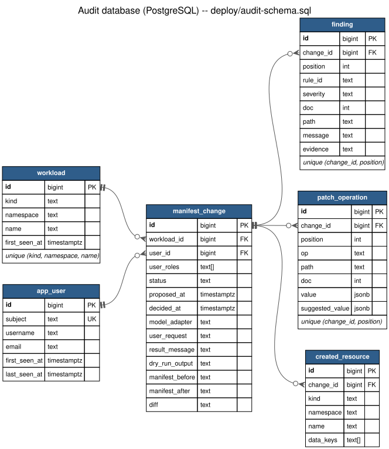
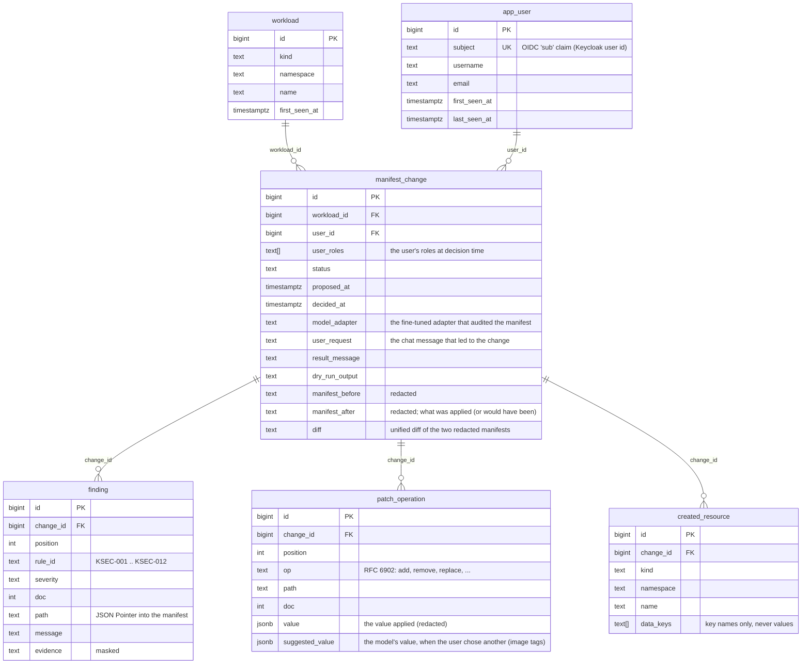

# Audit database

Every change the cluster agent proposes, and the user confirms or declines,
is recorded in PostgreSQL to keep a history of what changed in the cluster.
For each change it records who decided, when, which model audited the
manifest, the manifest before and after, the diff, the findings, every patch
operation and the resources the change created.

| | |
|---|---|
| Where | PostgreSQL 16.15 in minikube, namespace `audit` (`deploy/postgres.yaml`): one StatefulSet with a 1 GiB volume, Service NodePort 30432 |
| Schema | `deploy/audit-schema.sql`, applied by `deploy/setup_secure_demo.py` |
| Written by | `demo/audit_log.py`, called from the agent's toolbox (`demo/agent.py`) on every decision |
| Read by | the app's sidebar → **Show change history**, or `finetune/.venv/bin/python -m demo.audit_log [--show ID]` |

## Entity diagram

<!-- er-diagram:start (generated by deploy/audit_er_diagram.py) -->

<!-- er-diagram:end -->

Regenerate the diagram after changing the schema with
`python deploy/audit_er_diagram.py`. It rewrites the Mermaid block above and
`audit-er-diagram.{dot,svg,png}`.

## Tables

| Table | One row per | Notes |
|---|---|---|
| `app_user` | Keycloak user who decided on a change | `subject` is the OIDC `sub` claim (stable across renames); username/e-mail are refreshed on each record |
| `workload` | resource the agent changed (kind, namespace, name) | unique per (kind, namespace, name): a resource's whole history hangs off one row |
| `manifest_change` | decided change | `status`: `applied`, `declined`, `rejected` (refused before touching the cluster: unpinned image, failed dry run, not an operator) or `failed` (an apply against the cluster failed); `user_roles` are the roles at decision time |
| `finding` | problem the fine-tuned model reported for that change | rule, severity, JSON Pointer, masked evidence |
| `patch_operation` | RFC 6902 operation of the fix | `value` is what was applied; `suggested_value` is the model's value when the user chose another one (image tags) |
| `created_resource` | resource the fix created (e.g. the Secret a credential moves into) | key names only, never values |

`change_history` is a view with one line per change, used by the listings.

## Guarantees

- **Append-only.** The app connects as `audit_writer`, which may only
  `INSERT` and `SELECT` (plus refresh a user's name, e-mail and last-seen
  time). It can't `UPDATE`, `DELETE` or create tables. On top of that,
  triggers refuse `UPDATE`/`DELETE` on `manifest_change`, `finding`,
  `patch_operation` and `created_resource` for every role, including the
  tables' owner. `setup_secure_demo.py` checks these permissions each time
  it runs.
- **No secrets stored.** Values at the paths of a plaintext credential
  (KSEC-001, found by the project's detectors or reported by the model) are
  masked to their first 4 characters + `***` in both manifests, in the diff
  and in patch values. Created Secrets are stored as their key names only.
- **Nothing is applied unless it can be recorded.** While the database is
  unreachable, Confirm is disabled. The agent refuses to apply and keeps the
  change pending, so it can be confirmed once the database is back. If a
  record fails after the change was applied, the user is told explicitly.
- **TLS only.** `pg_hba.conf` rejects remote connections without TLS. The
  app connects with `sslmode=verify-full` against the demo's local CA
  (the certificate names the minikube IP).
- **Out of the agent's reach.** `audit` is a protected namespace: the
  agent's tools refuse and hide it, and its service account can't change
  anything or read Secrets there (also checked by `setup_secure_demo.py`).
- **Hardened pod.** It runs as non-root (uid 999) with a read-only root
  filesystem, all capabilities dropped and no service-account token.
  Resource limits are set.

## Limitations

- One instance, no backups or replication: fine for a local demo, not for
  production.
- A change the user never decides on (the browser is closed while it's
  pending) isn't recorded.
- `kubectl` changes made outside the agent aren't recorded. This is the
  agent's audit trail, not the cluster's. Kubernetes audit logging covers
  the rest.
- The user's chat message is stored as typed. A credential pasted into the
  chat would be stored too.
